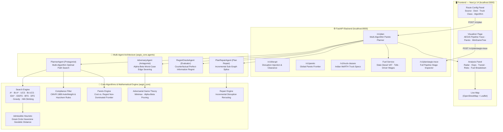

# AEGIS — Resilience-Aware Logistics Planning

AEGIS answers: *how badly does a feasible delivery plan fail when conditions change, and what cost premium buys less failure?*

---

## Architecture



### Key design decisions

| Decision | Rationale |
|---|---|
| Pareto frontier over single plan | Decision-maker gets the full cost vs. regret trade-off spectrum, not a black-box single answer |
| Indian MoRTH / CMVR 1989 truck classes | Payload and GVW limits match actual permit categories (LCV → MHCV), so the planner rejects physically infeasible loads |
| Risk score = 0.5 × norm_cost + 0.5 × regret | Equal-weight combination picks the route that is neither the costliest nor the most fragile |
| OSM Nominatim geocoding | No API key required; any Indian address or pin-code resolves to a lat/lon and is stitched into the logistics graph via feeder corridors |

---

## Quick start (Docker — recommended)

```bash
# 1. Clone and configure
cp .env.example .env          # edit if needed (keys are pre-set for local dev)

# 2. Launch everything
docker compose up --build

# 3. Open the UI
open http://localhost:3000

# 4. Explore the API docs
open http://localhost:8000/docs   # Header: X-API-Key: local-dev-key
```

Docker spins up: **FastAPI** · **Next.js**.

---

## Local development (no Docker)

### Backend

```bash
# Python 3.11+
python3.11 -m venv .venv && source .venv/bin/activate

# Install aegis_core (editable) + API dependencies
pip install -e ./core -e ./sdk -r services/api/requirements.txt

# Copy env
cp .env.example .env

# Start the API (auto-reload on file change)
uvicorn services.api.app.main:app --reload --port 8000
```

### Frontend

```bash
cd frontend
npm install
npm run dev          # http://localhost:3000
```

> Both services can run simultaneously. The Next.js dev server proxies API calls to `http://localhost:8000` via `NEXT_PUBLIC_API_URL`.

---

## Environment variables

| Variable | Default | Description |
|---|---|---|
| `AEGIS_API_KEY` | `local-dev-key` | API key sent as `X-API-Key` header |
| `NEXT_PUBLIC_API_URL` | `http://localhost:8000` | Backend URL consumed by the Next.js frontend |

---

## How the AEGIS multi-agent pipeline works

```
1. Load graph      POST /v1/graph       → depots (nodes) + routes (edges) with cost, time_hours, risk_prior
2. Load shipment   POST /v1/shipments   → origin, destination, goods_type, weight_kg
3. Truck check     POST /v1/plan        → cargo_weight_kg > max_payload_kg → HTTP 422 (rejected by CMVR 1989)
4. Multi-Search    PlannerAgent & ResiliencePlanner.frontier()
                     ├─ Selected Algorithm: A*, Bidirectional A*, UCS, Bidirectional UCS, IDA*, IDDFS, etc.
                     ├─ Auto-derives admissible great-circle Haversine heuristic from depot coordinates
                     ├─ Sweeps risk-weight parameter λ ∈ [0.0, 10.0] with effective edge cost c'(e) = c(e)·(1 + λ·R(e))
                     └─ Builds cost vs. regret Pareto frontier via non-dominance filtering
5. Adversarial     AdversaryAgent.find_worst_disruption()
                     └─ Alpha-Beta pruning finds worst-case edge blockage maximizing logistical regret
6. Regret Oracle   RegretOracleAgent.evaluate_regret()
                     └─ Counterfactual regret R(P|S) = Cost(P|S) - Cost(P*_S|S) with emergency turnaround factor
7. Plan Repair     PlanRepairAgent.repair()
                     └─ Incremental sub-graph repair re-routes around severed links without losing prefix hops
8. Enrich & Score  For each plan:
                     ├─ Aggregate risk_score via bounded exponential decay: 1 - exp(-∑ severities)
                     ├─ Composite recommendation score: 0.5 × norm_cost + 0.5 × risk_score
                     └─ Fuel economics: state-by-state diesel VAT, NHAI tolls, and driver allowances
9. Return          list[PlanResponse] — Pareto-optimal plans enriched with risks, breakdown, and is_best
```

---

## Truck classes (Indian standards — MoRTH / CMVR 1989)

| Key | Category | Max Payload | GVW Limit |
|---|---|---|---|
| `lcv` | Light Commercial Vehicle | 3,500 kg | 7,500 kg |
| `icv` | Intermediate Commercial Vehicle | 7,000 kg | 12,000 kg |
| `mcv` | Medium Commercial Vehicle | 10,000 kg | 16,200 kg |
| `hcv` | Heavy Commercial Vehicle (2-axle) | 16,200 kg | 25,000 kg |
| `hcv_multi` | HCV Multi-Axle (national permit) | 25,000 kg | 40,200 kg |
| `mhcv` | Over-Dimensional Cargo (special permit) | 40,000 kg | 55,000 kg |

The planner rejects a shipment whose `weight_kg` exceeds the selected class's max payload and returns HTTP 422 with a human-readable message.

---

## 🗺️ Codebase Feature, Agent & Formula Mapping

This section maps every project capability, multi-agent role, mathematical formula, search algorithm, and API route to its exact file location and function definition.

### 1. Multi-Agent System (`core/aegis_core/agents/`)

| Agent | Architecture Role | File Path | Primary Function / Class | Description |
|---|---|---|---|---|
| **PlannerAgent** | Protagonist (Route Optimiser) | [`core/aegis_core/agents/planner_agent.py`](core/aegis_core/agents/planner_agent.py) | `PlannerAgent.solve()` | Executes multi-algorithm heuristic path planning (A*, Bi-A*, UCS, IDA*, etc.) across candidate risk-aversion weights $\lambda$ to generate cost-efficient, hazard-resilient routes. |
| **AdversaryAgent** | Antagonist (Disruption Seeker) | [`core/aegis_core/agents/adversary_agent.py`](core/aegis_core/agents/adversary_agent.py) | `AdversaryAgent.find_worst_disruption()` | Employs game-theoretic Alpha-Beta pruning over candidate route networks to discover worst-case bottleneck disruptions that maximize route regret. |
| **RegretOracleAgent** | Evaluator (Regret Assessor) | [`core/aegis_core/agents/oracle_agent.py`](core/aegis_core/agents/oracle_agent.py) | `RegretOracleAgent.evaluate_regret()` | Evaluates counterfactual perfect-information regret $R(P \mid S)$ comparing candidate plan execution against an omniscient competitor plan, applying turnaround penalties on impassable links. |
| **PlanRepairAgent** | Plan Repair (Dynamic Recovery) | [`core/aegis_core/agents/repair_agent.py`](core/aegis_core/agents/repair_agent.py) | `PlanRepairAgent.repair()` | Slices the intact route prefix and dynamically splices an optimal bypass from the current position to destination, avoiding severed corridors without restarting. |

---

### 2. Search & Game-Theoretic Algorithms (`core/aegis_core/algorithms/`)

| Algorithm | Paradigm | File Path | Function Name | Characteristics & Guarantees |
|---|---|---|---|---|
| **A\*** | Heuristic Best-First | [`core/aegis_core/algorithms/search.py`](core/aegis_core/algorithms/search.py) | `astar()` | Optimal and complete when using admissible heuristic ($h(n) \le h^*(n)$). Explores states ordered by $f(n) = g(n) + h(n)$. |
| **Bidirectional A\*** | Symmetrical Heuristic | [`core/aegis_core/algorithms/search.py`](core/aegis_core/algorithms/search.py) | `bidirectional_astar()` | Simultaneous forward ($s \to g$) and backward ($g \to s$) A* search frontiers. Dramatically cuts search space radius by meeting in the middle. |
| **Uniform Cost Search (UCS / Dijkstra)** | Cost-Optimal Uninformed | [`core/aegis_core/algorithms/search.py`](core/aegis_core/algorithms/search.py) | `ucs()`, `dijkstra()` | Priority queue ordered strictly by accumulated path cost $g(n)$. Guarantees cost-optimal solution for non-negative edge costs. |
| **Bidirectional UCS** | Dual-Frontier Dijkstra | [`core/aegis_core/algorithms/search.py`](core/aegis_core/algorithms/search.py) | `bidirectional_ucs()` | Expands lowest $g(n)$ frontiers from both origin and destination until intersection, minimizing explored node count. |
| **IDA\* (Iterative Deepening A\*)** | Depth-Bounded Heuristic | [`core/aegis_core/algorithms/search.py`](core/aegis_core/algorithms/search.py) | `ida_star()` | Memory-bounded ($O(bd)$ space) heuristic search that performs successive DFS iterations with $f$-cost cutoffs. |
| **IDDFS & DLS** | Iterative Deepening / Depth-Limited | [`core/aegis_core/algorithms/search.py`](core/aegis_core/algorithms/search.py) | `iddfs()`, `dls()` | Combines BFS completeness with DFS linear space efficiency ($O(bd)$). Finds shallowest hop path without exponential memory growth. |
| **Breadth-First Search (BFS)** | Level-Order Uninformed | [`core/aegis_core/algorithms/search.py`](core/aegis_core/algorithms/search.py) | `bfs()` | FIFO queue exploration. Finds path with minimal transfer hops across depots. |
| **Depth-First Search (DFS)** | Depth-First Uninformed | [`core/aegis_core/algorithms/search.py`](core/aegis_core/algorithms/search.py) | `dfs()` | LIFO stack exploration with cycle detection. Rapidly finds feasible paths when memory is scarce. |
| **Greedy Best-First** | Heuristic Pure-Greedy | [`core/aegis_core/algorithms/search.py`](core/aegis_core/algorithms/search.py) | `greedy_best_first()` | Explores strictly by minimal $h(n)$ (distance to goal). Extremely fast path discovery for large graphs. |
| **Hill Climbing (Random Restarts)** | Local Heuristic Search | [`core/aegis_core/algorithms/search.py`](core/aegis_core/algorithms/search.py) | `hill_climbing_random_restart()` | Iterative local greedy descent with stochastic restarts to escape local optima and dead ends. |
| **Unified Dispatcher** | Algorithm Routing | [`core/aegis_core/algorithms/search.py`](core/aegis_core/algorithms/search.py) | `find_path()` | Unified entrypoint supporting algorithm selection, heuristic auto-wiring, and bidirectional hooks. |
| **Minimax Search** | Adversarial Game Tree | [`core/aegis_core/algorithms/adversarial.py`](core/aegis_core/algorithms/adversarial.py) | `minimax()` | Two-player zero-sum formulation where Logistics Planner minimizes cost while Adversary maximizes disruption impact. |
| **Alpha-Beta Pruning** | Branch-and-Bound Game Tree | [`core/aegis_core/algorithms/adversarial.py`](core/aegis_core/algorithms/adversarial.py) | `alpha_beta()` | Mathematically identical to Minimax while pruning provably sub-optimal decision branches ($\alpha \ge \beta$). |
| **Adversarial Disruption Generator** | Stress-Test Generator | [`core/aegis_core/algorithms/adversarial.py`](core/aegis_core/algorithms/adversarial.py) | `generate_adversarial_disruption()` | Identifies and outputs candidate edge severances targeting single points of failure in the active delivery plan. |

---

### 3. Mathematical Formulas & Theoretical Foundations

#### Formula 1: Great-Circle Haversine Geodetic Distance
Calculates the shortest spherical distance over Earth's surface between two geographical coordinates:
$$\Delta\sigma = 2 \arcsin\left(\sqrt{\sin^2\left(\frac{\Delta\phi}{2}\right) + \cos\phi_1\cos\phi_2\sin^2\left(\frac{\Delta\lambda}{2}\right)}\right),\quad d = R \cdot \Delta\sigma$$
- **Code File**: [`core/aegis_core/algorithms/search.py`](core/aegis_core/algorithms/search.py) — `haversine_km()`
- **Significance**: Provides exact distance in kilometers without external GIS or web services ($R \approx 6371.0\text{ km}$).

#### Formula 2: Admissible & Monotonically Consistent Heuristic
A\* and IDA\* require an admissible heuristic ($h(u) \le h^*(u)$) to guarantee cost-optimal solutions:
$$h(u) = c_{\min} \cdot \text{haversine\_km}(\text{coords}[u], \text{coords}[v_{\text{goal}}])$$
Because straight-line geodetic distance on a sphere satisfies the triangle inequality and roads cannot physically be shorter than Euclidean distance:
$$h(u) \le c(u, v) + h(v) \quad (\text{Triangle inequality / Monotonic consistency})$$
- **Code File**: [`core/aegis_core/algorithms/search.py`](core/aegis_core/algorithms/search.py) — `great_circle_heuristic()`
- **Significance**: Guarantees optimal pathfinding with zero node re-evaluations under A* and IDA*.

#### Formula 3: Multi-Hazard Probabilistic Risk Aggregation
For an edge $e$ subject to multiple independent disruption threats $\mathcal{D}(e)$ (weather, labour strike, flooding):
$$R(e) = 1 - \prod_{d \in \mathcal{D}(e)} \big(1 - \text{severity}(d)\big) \in [0, 1]$$
- **Code File**: [`core/aegis_core/services/risk.py`](core/aegis_core/services/risk.py) — `edge_risk()`
- **Significance**: Aggregates independent hazard failure probabilities without double-counting severities.

#### Formula 4: Risk-Penalized Effective Edge Cost
To incorporate risk tolerance into path planning, AEGIS augments baseline edge cost $c(e)$ with a risk-aversion penalty parameter $\lambda \ge 0$:
$$c'(e) = c(e) \cdot \big(1 + \lambda R(e)\big)$$
- **Code File**: [`core/aegis_core/services/planner.py`](core/aegis_core/services/planner.py) — `ResiliencePlanner.plan()` and `ResiliencePlanner.frontier()`
- **Significance**: At $\lambda=0$, the planner seeks the cheapest nominal path; as $\lambda \to \infty$, it routes strictly around hazardous links. Sweeping $\lambda \in [0.0, 0.5, 1.0, 2.0, 5.0, 10.0]$ maps the full cost-versus-regret trade-off spectrum.

#### Formula 5: Pareto Dominance & Frontier Optimization
A plan $P_1$ strictly dominates plan $P_2$ ($P_1 \succ P_2$) if and only if it is no worse in both objectives and strictly better in at least one:
$$P_1 \succ P_2 \iff \big(\text{cost}(P_1) \le \text{cost}(P_2) \land \text{regret}(P_1) \le \text{regret}(P_2)\big) \land \big(\text{cost}(P_1) < \text{cost}(P_2) \lor \text{regret}(P_1) < \text{regret}(P_2)\big)$$
The Pareto Frontier $\mathcal{P}^*$ retains only non-dominated plans:
$$\mathcal{P}^* = \{ P \in \Omega \mid \nexists P' \in \Omega \text{ such that } P' \succ P \}$$
- **Code File**: [`core/aegis_core/services/pareto.py`](core/aegis_core/services/pareto.py) — `is_dominated()`, `pareto_frontier()`
- **Significance**: Filters out sub-optimal solutions and returns the minimal set of trade-off options for executive decision-making.

#### Formula 6: Counterfactual Perfect-Information Regret with Turnaround Penalty
Measures the loss incurred by committing to plan $P$ compared to an oracle plan $P^*_S$ designed with perfect foreknowledge of disruption scenario $S$:
$$R(P \mid S) = \text{Cost}(P \mid S) - \text{Cost}(P^*_S \mid S)$$
$$\text{where } \text{Cost}(P \mid S) = \sum_{e \in P} c(e) \cdot \begin{cases} 2.5 & \text{if } \text{edge } e \text{ is severed } (\text{severity} \ge 1.0) \\ 1.0 + \text{severity}(e) & \text{otherwise} \end{cases}$$
- **Code File**: [`core/aegis_core/agents/oracle_agent.py`](core/aegis_core/agents/oracle_agent.py) — `RegretOracleAgent.evaluate_regret()`
- **Significance**: Accurately reflects real-world supply chain penalties: reaching an impassable road closure requires U-turns, emergency holding depots, and expensive expedited re-routing.

#### Formula 7: Exponential-Decay Route Risk & Composite Recommendation Score
Aggregates route-level disruption exposure into a normalized bounded risk index in $[0, 1)$:
$$\text{RiskScore}(P) = 1 - \exp\left(-\sum_{d \in \text{active}(P)} \text{severity}(d)\right)$$
The optimal balanced plan recommendation $P_{\text{best}}$ minimizes equal-weighted normalized cost and risk:
$$\text{RecommendationScore}(P) = 0.5 \cdot \frac{\text{cost}(P) - \min_Q \text{cost}(Q)}{\max_Q \text{cost}(Q) - \min_Q \text{cost}(Q) + 10^{-6}} + 0.5 \cdot \text{RiskScore}(P)$$
$$P_{\text{best}} = \arg\min_{P \in \mathcal{P}^*} \text{RecommendationScore}(P)$$
- **Code File**: [`services/api/app/main.py`](services/api/app/main.py) — `_aggregate_risk_score()`, `_recommendation()`
- **Significance**: Identifies the "Goldilocks" plan that avoids both high financial waste and catastrophic physical fragility.

#### Formula 8: Commercial Vehicle Fuel, Toll & Driver Cost Formulation
$$\text{Total Trip Cost (₹)} = \left(\frac{\text{Distance (km)}}{\text{Class Mileage (km/L)}}\right) \times \text{Diesel Price}_{\text{State}} + \sum_{\text{plazas}} \text{Toll}(\text{Axle Count}) + \text{Driver Wages}$$
- **Code File**: [`services/api/app/fuel_service.py`](services/api/app/fuel_service.py) — `compute_fuel_cost()`
- **Significance**: Reflects real Indian interstate freight economics with state-specific diesel VAT differentials (e.g. Maharashtra ₹92.5/L vs Delhi ₹87.7/L) and NHAI FASTag toll schedules.

---

### 4. Regulatory & Vehicle Compliance (`core/aegis_core/services/compliance.py`)

| Feature | Code File | Function / Schema | Rule & Verification |
|---|---|---|---|
| **GVW & Payload Validation** | [`services/api/app/schemas.py`](services/api/app/schemas.py), [`services/api/app/main.py`](services/api/app/main.py) | `validate_cargo_weight()`, `TRUCK_CLASSES` | Rejects shipments where $\text{cargo\_weight\_kg} > \text{max\_payload\_kg}$ with HTTP 422 before search execution. |
| **Cargo Category Compliance** | [`core/aegis_core/services/compliance.py`](core/aegis_core/services/compliance.py) | `route_is_compliant()` | Ensures restricted goods types (`hazchem`, `perishable`, `oversized`) only traverse certified edges matching vehicle permits. |
| **Dynamic Sub-Graph Plan Repair** | [`core/aegis_core/services/repair.py`](core/aegis_core/services/repair.py) | `repair_plan()` | Isolates disrupted segments and splices a compliant detour from the current position to the destination depot. |

---

### 5. API Endpoints to Backend Implementation Mapping

| HTTP Method | Route | Schema In / Out | Controller File | Underlying Engine Calls |
|---|---|---|---|---|
| `POST` | `/v1/graph` | `GraphInput` $\to$ status | [`services/api/app/main.py`](services/api/app/main.py) | `planner().adjacency`, `store.set_graph()` |
| `POST` | `/v1/shipments` | `list[ShipmentInput]` $\to$ status | [`services/api/app/main.py`](services/api/app/main.py) | `store.add_shipments()` |
| `POST` | `/v1/plan` | `PlanRequest` $\to$ `list[PlanResponse]` | [`services/api/app/main.py`](services/api/app/main.py) | `validate_cargo_weight()`, `planner().frontier(algorithm=request.algorithm)`, `compute_fuel_cost()` |
| `POST` | `/v1/disrupt` | `DisruptionInput` $\to$ status | [`services/api/app/main.py`](services/api/app/main.py) | `store.add_disruption()`, `Disruption` |
| `DELETE` | `/v1/disrupt` | None $\to$ status | [`services/api/app/main.py`](services/api/app/main.py) | `store.clear_disruptions()` |
| `POST` | `/v1/plan/{id}/replan` | Replan request $\to$ `list[PlanResponse]` | [`services/api/app/main.py`](services/api/app/main.py) | `PlanRepairAgent.repair()`, `repair_plan()` |
| `POST` | `/v1/plan/aegis-trace` | `AegisTraceRequest` $\to$ `AegisTraceResponse` | [`services/api/app/main.py`](services/api/app/main.py) | `find_path()`, `frontier()`, `_aggregate_risk_score()`, step trace instrumentation |
| `GET` | `/v1/pareto` | None $\to$ `list[PlanResponse]` | [`services/api/app/main.py`](services/api/app/main.py) | `pareto_frontier()` over `store.plans` |
| `GET` | `/v1/truck-classes` | None $\to$ `dict[str, TruckClassSpec]` | [`services/api/app/main.py`](services/api/app/main.py) | `TRUCK_CLASSES` dictionary lookup |

---

### 6. Frontend UI Components (`frontend/`)

| UI Component | File Path | Functionality |
|---|---|---|
| **Main Dashboard** | [`frontend/app/page.tsx`](frontend/app/page.tsx) | Live interactive map with routing overlay, glassmorphic control drawer, truck class picker, and analysis cards. |
| **Pipeline Visualizer** | [`frontend/app/visualizer/page.tsx`](frontend/app/visualizer/page.tsx) | Deep-dive analytical view inspecting AEGIS search iterations, Pareto frontier plots, and game-theoretic Minimax disruption trees. |
| **Interactive Map** | [`frontend/components/MapView.tsx`](frontend/components/MapView.tsx) | Leaflet / OpenStreetMap component rendering depot nodes, active routes, and pulse markers on disrupted highway segments. |
| **Source & Destination Picker** | [`frontend/components/SourceDestPicker.tsx`](frontend/components/SourceDestPicker.tsx) | Address input with OSM Nominatim geocoding, MoRTH truck class selector, and search algorithm selector (`astar`, `bidirectional_astar`, `ucs`, etc.). |
| **Analysis Panel** | [`frontend/components/AnalysisPanel.tsx`](frontend/components/AnalysisPanel.tsx) | Cost vs. risk trade-off breakdown, transit time, risk severity tags, fuel/toll estimate, and Goldilocks recommendation badge. |
| **Pipeline Trace Graph** | [`frontend/components/AegisTraceGraph.tsx`](frontend/components/AegisTraceGraph.tsx) | Visualizes the 5 stages of the AEGIS decision lifecycle (Graph Filter $\to$ Search $\to$ Regret Oracle $\to$ Pareto $\to$ Enrich). |
| **Game Tree Visualizer** | [`frontend/components/MiniGameTree.tsx`](frontend/components/MiniGameTree.tsx) | Interactive Minimax / Alpha-Beta visualization showing protagonist vs. antagonist move choices. |
| **Event Console** | [`frontend/components/EventConsole.tsx`](frontend/components/EventConsole.tsx) | Live scrolling terminal streaming WebSocket simulation events and disruption alerts. |

---

## Project layout

```
AEGIS/
├── core/                           # aegis_core — pure Python library
│   └── aegis_core/
│       ├── __init__.py             # Clean public re-exports (models, algorithms, agents, services)
│       ├── domain/
│       │   └── models.py           # Depot, Route, Shipment, Plan, Disruption data models
│       ├── algorithms/
│       │   ├── search.py           # A*, Bi-A*, UCS, Bi-UCS, IDA*, IDDFS, BFS, DFS, Greedy, Hill-Climbing
│       │   └── adversarial.py      # Minimax, Alpha-Beta Pruning, Adversarial Disruption Synthesis
│       ├── agents/
│       │   ├── planner_agent.py    # PlannerAgent (Protagonist Route Optimiser)
│       │   ├── adversary_agent.py  # AdversaryAgent (Antagonist Bottleneck Disrupter)
│       │   ├── oracle_agent.py     # RegretOracleAgent (Counterfactual Regret Evaluator)
│       │   └── repair_agent.py     # PlanRepairAgent (Incremental Sub-Graph Splicer)
│       ├── services/
│       │   ├── planner.py          # ResiliencePlanner — Pareto frontier and risk-weighted plan generation
│       │   ├── pareto.py           # Pareto dominance filter & frontier deduplication
│       │   ├── risk.py             # Multi-hazard probabilistic risk aggregation
│       │   ├── repair.py           # Incremental sub-graph plan repair service
│       │   └── compliance.py       # CMVR 1989 Axle/Weight & Hazchem Permit Verification
│       └── tests/
│           ├── test_search.py      # Unit tests for all 10+ search algorithms
│           ├── test_adversarial.py # Minimax & Alpha-Beta game tree tests
│           ├── test_agents.py      # Tests for all 4 agents and plan repair
│           ├── test_pareto.py      # Pareto non-dominance verification
│           └── test_planner.py     # End-to-end ResiliencePlanner tests
├── services/
│   └── api/                        # FastAPI planning backend
│       ├── requirements.txt
│       ├── app/
│       │   ├── main.py             # Route handlers, recommendation score, trace pipeline
│       │   ├── schemas.py          # PlanRequest (with algorithm), PlanResponse, TRUCK_CLASSES
│       │   ├── fuel_service.py     # State diesel VAT, NHAI FASTag tolls, driver wages
│       │   ├── store.py            # In-memory thread-safe state store
│       │   └── config.py           # API settings & environment config
│       └── tests/
│           └── test_api.py         # End-to-end API tests (planning, disruptions, algorithms)
├── frontend/                       # Next.js 14 Web Application
│   ├── app/
│   │   ├── page.tsx                # Main live map dashboard & control drawer
│   │   └── visualizer/page.tsx     # AEGIS trace & game-tree visualizer
│   ├── components/
│   │   ├── MapView.tsx             # Interactive Leaflet / OpenStreetMap component
│   │   ├── SourceDestPicker.tsx    # Address input, truck class & algorithm selection
│   │   ├── AnalysisPanel.tsx       # Metrics, fuel breakdown, risk badges, recommendation
│   │   ├── AegisTraceGraph.tsx     # Stage-by-stage pipeline visualizer
│   │   ├── MiniGameTree.tsx        # Minimax/Alpha-Beta game tree visualization
│   │   └── EventConsole.tsx        # Real-time WebSocket event console
│   └── lib/
│       ├── api.ts                  # Typed Axios/Fetch API client
│       ├── constants.ts            # India national backbone network (depots & routes)
│       └── dynamicGraph.ts         # OSM Nominatim geocoding & corridor feeder injection
├── sdk/                            # Python SDK client for AEGIS API
├── examples/                       # Sample JSON disruption & shipment payloads
└── docs/                           # Architecture and algorithm deep-dive documentation
```

---

## API reference (key endpoints)

| Method | Path | Description |
|---|---|---|
| `POST` | `/v1/graph` | Upload depot + route graph |
| `POST` | `/v1/shipments` | Register shipments |
| `POST` | `/v1/plan` | Run AEGIS — returns Pareto-optimal plans with truck check, risks, `is_best` |
| `GET` | `/v1/truck-classes` | List all supported Indian truck classes |
| `POST` | `/v1/disrupt` | Inject a disruption (road closure, strike, etc.) |
| `POST` | `/v1/plan/{id}/replan` | Replan after disruption |
| `POST` | `/v1/plan/aegis-trace` | Stage-by-stage pipeline trace (visualiser) |
| `GET` | `/v1/pareto` | Global Pareto frontier across all stored plans |
| `GET` | `/v1/metrics` | Prometheus metrics |
| `WS` | `/v1/stream/simulation` | Live simulation event stream |

Interactive docs: **http://localhost:8000/docs** (Swagger UI)

---

## Running tests

```bash
# Backend
source .venv/bin/activate
pytest core/tests/ services/api/tests/ -v

# Lint
ruff check .

# Frontend type-check
cd frontend && npx tsc --noEmit
```

---

## Included examples

- `examples/last_mile_weather.json` — weather disruption on a perishable shipment
- `examples/multi_depot_strike.json` — labour strike closing multiple edges simultaneously

See [docs/implementation-plan.md](docs/implementation-plan.md), [docs/architecture.md](docs/architecture.md), and [docs/algorithms.md](docs/algorithms.md) for deeper reading.
